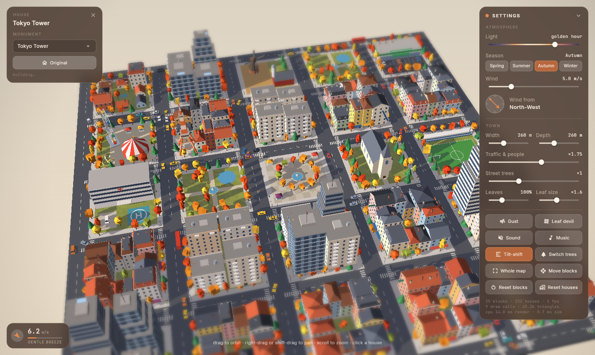

# Low-Poly Tile City

Một thị trấn low-poly ấm áp, sinh thủ tục trên bàn cờ ô vuông, chạy ngay trong trình duyệt. Viết bằng Flutter (web).

**Chơi thử:** https://danny-exnodes.github.io/low-poly-tile-city/



## Tính năng

- **Thành phố sinh thủ tục:** nhà phố, nhà vườn, chung cư, văn phòng, công viên có hồ, quảng trường đài phun nước, hội chợ (vòng quay, đu quay, lều xiếc), nông trại cối xay gió, siêu thị có bãi đỗ xe, bệnh viện có bãi trực thăng, sân bóng, nhà thờ.
- **Phố xá sống động:** xe chạy theo làn và rẽ ở ngã tư; người đi dạo trên vỉa hè.
- **Khí quyển:** ánh sáng theo giờ (bình minh → golden hour → đêm, đèn cửa sổ và đèn đường), bốn mùa (hoa xuân, lá hè, lá thu, tuyết đông với cây trụi lá), bóng đổ theo mặt trời.
- **Gió:** thanh tốc độ và la bàn kéo được; cây lắc, lá (hoặc cánh hoa, tuyết) bay, rơi và đọng lại. **Gust** tạo cơn gió mạnh; **Leaf devil** tạo lốc xoáy đi ngang thị trấn cuốn lá lên.
- **Tượng đài:** click một ngôi nhà để thay bằng Tokyo Tower, Christ the Redeemer, Petronas Towers, Sagrada Familia, St Basil's Cathedral, Atomium, Gateway Arch, Stonehenge, cối xay gió Hà Lan hoặc tượng Moai. **Original** trả lại ngôi nhà cũ.
- **Công cụ thị trấn:** rộng/sâu của bản đồ (ô mới là đất trống), mật độ xe và người, cây đường phố, lượng lá và cỡ lá, **Switch trees**, **Move blocks** (chạm hai khối để đổi chỗ), **Reset blocks**, **Reset houses**, **Whole map**, **Tilt-shift**.
- **Âm thanh và nhạc:** âm thanh môi trường tạo bằng Web Audio (gió, lá xào xạc, chim, dế ban đêm, xe cộ, tiếng gõ khi xây) và nhạc nền sinh tự động.

## Điều khiển

| Thao tác | Cách làm |
| --- | --- |
| Xoay | kéo chuột |
| Di chuyển | kéo chuột phải, shift + kéo, hoặc kéo hai ngón |
| Phóng to/thu nhỏ | lăn chuột / chụm hai ngón |
| Chọn nhà | click vào nhà |
| Chế độ xây | nút **Build**, click ô hoặc công trình; Ctrl/⌘+Z hoàn tác; Esc thoát |

## Phiên bản

**Mới trong v0.0.4**
- Chế độ **Build**: click một ô để đổi thành 13 loại (đất trống, nhà vườn, nhà phố, trung tâm, chung cư, công viên, quảng trường, hội chợ, nông trại, siêu thị, bệnh viện, sân bóng, nhà thờ), tạo biến thể hoặc dọn sạch (#7).
- Click một công trình để đổi kiểu, số tầng, màu tường, màu mái, kiểu mái, xoay, phá dỡ hoặc đặt tượng đài (#8).
- **Undo** (Ctrl/⌘+Z) cho mọi thao tác chỉnh sửa; Reset blocks trả lại cả loại ô gốc.

**Mới trong v0.0.3**
- Phong cách low-poly mềm: ánh sáng dịu (hết cháy sáng giữa trưa), chân tường và mặt dưới tán cây tối dần, cạnh tường bo tròn, tán cây tròn, tượng đài nhiều cạnh hơn, khử răng cưa trên màn hình thường (tự tắt nếu máy chậm; nút **Smooth edges**) (#5).
- Công trình được xây dần từng tầng, từ dưới lên; mở app thấy thị trấn dựng từng khối từ trung tâm ra (click để bỏ qua); đổi tượng đài, đổi chỗ khối, Reset houses đều có nhà cũ thu xuống và nhà mới mọc lên (#6).

**Mới trong v0.0.2**
- Mở rộng bản đồ chỉ thêm ô đất trống; ô bị cắt khi thu nhỏ được trả lại khi mở rộng (#3).
- Giảm lag: bóng đổ khi kéo Light 34 → ~2 ms, tilt-shift tốn GPU ×3,1 → ×1,15, đổi chỗ 2 khối 40–52 → ~3 ms, ít hơn 40% tam giác phải vẽ (LOD cây, cành cây chỉ vẽ mùa đông); benchmark chạy trong CI (#4).
- Quy trình nhóm agent (`.claude/skills/`), `CLAUDE.md`, checkpoint phát hành (#2).

Các bản: [v0.0.4](docs/releases/v0.0.4.md) · [v0.0.3](docs/releases/v0.0.3.md) · [v0.0.2](docs/releases/v0.0.2.md) · [v0.0.1](docs/releases/v0.0.1.md) — lộ trình ở issue #1.

## Chạy và build

```bash
flutter run -d chrome          # phát triển
flutter build web --release    # bản production trong build/web
flutter test                   # test mô phỏng + benchmark hiệu năng
```

Hiện chỉ cấu hình nền tảng web.

## Cách hoạt động

Không dùng engine 3D ngoài. `lib/engine` là một renderer phần mềm nhỏ: mesh dựng từ các khối low-poly (`mesh.dart`), tô sáng từng tam giác theo mô hình nắng + bầu trời có xử lý mùa, tuyết và đèn ban đêm (`lighting.dart`), rồi vẽ theo painter's algorithm (sắp object theo độ sâu, loại mặt sau, LOD khi ở xa) gộp vào vài lệnh `Canvas.drawVertices` (`renderer.dart`). Nền và bóng được cache thành `Picture` khi camera đứng yên; tilt-shift làm mờ một bản thu nhỏ của khung hình.

`lib/world` chứa thành phố sinh thủ tục (`city.dart`, `buildings.dart`, `monuments.dart`, `props.dart`), mô phỏng giao thông, gió và hạt (`simulation.dart`) và trạng thái chung (`world.dart`). `lib/ui` là các panel Flutter, `lib/audio` là engine Web Audio.

## Triển khai (GitHub Pages)

`.github/workflows/deploy-pages.yml` chạy `flutter analyze`, `flutter test` (gồm benchmark) và build web cho mọi push và pull request. Push vào `master` sẽ deploy lên GitHub Pages và, nếu `version:` trong `pubspec.yaml` chưa có release, tự tạo tag `v<version>` cùng GitHub Release kèm bản web nén zip.

## Đóng góp

Dự án dùng quy trình nhóm agent: xem `CLAUDE.md` và `.claude/skills/`.

Font: Inter và JetBrains Mono (SIL Open Font License).
